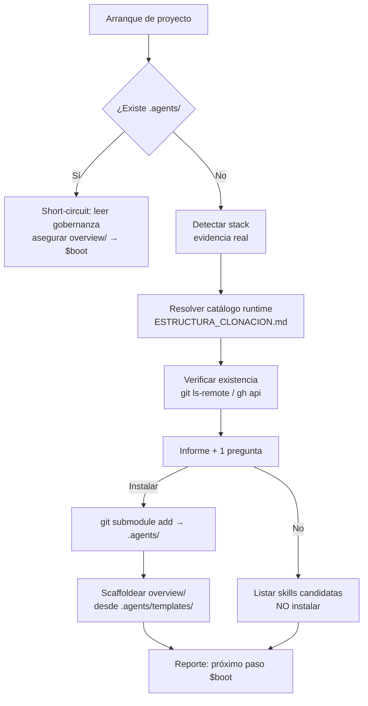

# 🌐 Ecosystem Bootstrap Agent Skill

> **Descripción** — Skill **transversal** que instala la gobernanza del [Agent-Rules-Ecosystem](https://github.com/Agent-Rules-Ecosystem) en un proyecto: detecta el stack, recomienda el core `*-agent-rules` correcto, lo instala como submódulo en `.agents/`, scaffoldea el `overview/` de track vivo y lista las skills compatibles sin instalarlas.

---

## 🎯 Propósito y Alcance

1. 🔍 **Detectar** el stack del proyecto leyendo archivos reales (`pubspec.yaml`, `package.json`, `go.mod`, `Cargo.toml`…), nunca por suposición.
2. 🗺️ **Resolver el catálogo en runtime** desde el repo núcleo del ecosistema y **verificar que cada repo exista** antes de recomendarlo.
3. 🛡️ **Instalar la gobernanza** (`*-agent-rules`) en `.agents/` como submódulo HTTPS, previa confirmación explícita del usuario.
4. 📊 **Scaffoldear `overview/`** desde `.agents/templates/` para arrancar el track vivo de avances (`$boot`, `$work`, `$close`).
5. 💡 **Listar las skills candidatas** (`*-agent-skill`) con su evidencia, sin preguntar ni instalar: si el usuario no dice nada, se ignoran.

## 💡 Comandos de Bootstrap

| Comando | Acción | Descripción |
|---|---|---|
| `$ecoproject` | Bootstrap | Detecta el stack, recomienda la gobernanza, pregunta e instala + scaffoldea `overview/` |
| `$ecoproject:audit` | Auditoría | Verifica la instalación existente (`.agents/`, `overview/`, `.skill/`) y reporta qué falta |
| `$ecoproject:catalog` | Catálogo | Resuelve y lista las gobernanzas y skills disponibles (verificadas online) |

> Los comandos son el atajo compatible con el estándar del ecosistema. La skill se activa igual por nombre (`skill({name})`), por slash (`/ecosystem-bootstrap-agent-skill`) o por auto-invocación cuando la descripción aplica.

## 🏗️ Arquitectura / Diagrama de Flujo



## 📦 Instalación como Submódulo

```bash
# Como skill del propio ecosistema (en un proyecto que ya tiene gobernanza)
mkdir -p .skill
git submodule add https://github.com/Mane-jaker/ecosystem-bootstrap-agent-skill.git .skill/ecosystem-bootstrap-agent-skill
```

Como skill global del ecosistema de skills abiertas:

```bash
npx skills add Mane-jaker/ecosystem-bootstrap-agent-skill@ecosystem-bootstrap-agent-skill -g -y
```

Trigger de activación: al iniciar un proyecto, al decir *"nuevo proyecto"* / *"empecemos"* / *"arrancamos"*, o al mencionar *agent rules*, *gobernanza*, *`.agents`*, *`$boot`*, *`overview/`* o el nombre del ecosistema.

## 🔗 Conexión con el ecosistema

Esta skill no duplica el catálogo: lo **resuelve** desde el repo núcleo (`ESTRUCTURA_CLONACION.md`) y valida cada repo contra GitHub. Por eso el README del ecosistema —que hoy lista repos todavía no publicados— no puede hacer que esta skill recomiende algo inexistente.

| Capa | Qué instala | Dónde |
|---|---|---|
| Gobernanza (`*-agent-rules`) | Cómo trabaja la IA: `$boot`, `$work`, `$close`, `overview/` | `.agents/` (submódulo) |
| Skills (`*-agent-skill`) | Qué sabe hacer la IA: patrones, auditorías, guías | `.skill/<repo>/` (submódulo) |

## 📄 Licencia

MIT — mismo criterio que el resto del ecosistema.
