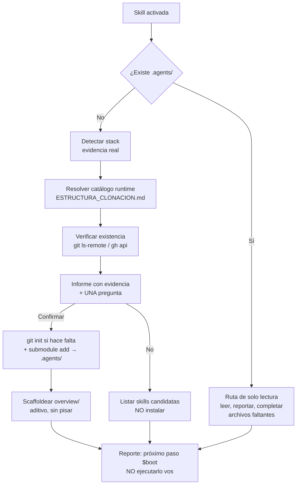

# Bootstrap del Agent-Rules-Ecosystem

Instala la gobernanza oficial del [Agent-Rules-Ecosystem](https://github.com/Agent-Rules-Ecosystem) en un proyecto: el core `*-agent-rules` que corresponde al stack, la carpeta `overview/` para llevar el track vivo de avances, y el catálogo de skills compatibles.

El ecosistema funciona en dos capas:
- **Gobernanza (`*-agent-rules`)** → define **CÓMO** trabaja la IA: rituales `$boot` / `$work` / `$close`, estado persistente en `overview/`, handoffs, economía de tokens. Se instala en `.agents/`.
- **Skills (`*-agent-skill`)** → define **QUÉ** sabe hacer la IA: patrones de código, auditorías de dominio, guías técnicas. Se instalan en `.skill/`.

Esta skill decide e instala la capa 1, y **recomienda** la capa 2 sin instalarla.

## 📊 Flujo de decisión




## Cuándo NO usar esta skill

- Si `.agents/` ya existe en el proyecto: la gobernanza está instalada. Esta skill no reinstala; lee la gobernanza vigente y se la entrega al agente. Ver [Paso 0](#paso-0--short-circuit-el-proyecto-ya-tiene-gobernanza).
- Si el usuario solo pide un cambio de código: no es momento de instalar nada. Solo intervení si el usuario pide explícitamente la gobernanza o si este es el arranque del proyecto.
- Si el usuario pide una skill concreta (`$bloc`, `$security`): instalala directo en `.skill/`, sin pasar por el catálogo completo.

## Flujo

Ejecutá los pasos en orden. Los pasos 0 y 1 no modifican nada; el paso 3 pide permiso; solo el 4 y el 5 escriben en disco — y el 0, en su versión aditiva, completa archivos de `overview/` que falten sin tocar los existentes.

### Paso 0 — Short-circuit: el proyecto ya tiene gobernanza

Comprobá si existe `.agents/` en la raíz del proyecto (o `knowledge/.agents/`, `vault/.agents/`, `docs/.agents/` en monorepos federados).

Si existe:
1. Leé `.agents/AGENTS.md` y `.agents/core/commands.md` — ahí viven los rituales y las reglas reales.
2. Verificá que exista `overview/`. Si falta, hacé el scaffold del [Paso 5](#paso-5--scaffoldear-overview) (no reinstales la gobernanza).
3. Reportá el estado y **cedé el control a la gobernanza instalada**: los comandos `$boot`, `$work`, `$close` son de la gobernanza, no de esta skill. No los reimplementes.

**Esta ruta es de solo lectura sobre el estado del proyecto.** Concretamente:

- **No modifiques ningún archivo que ya exista en `overview/`.** Ni `session.md`, ni `work.md`, ni `work/tasks.md`, ni `work_review.md`. El trabajo en curso es del usuario y de su agente: yours es reportarlo, no corregirlo.
- Si `overview/` está incompleto, **solo completá los archivos que no existen** (copia desde `.agents/templates/`) y nada más. No "actualicés" `work.md` moviendo ítems a Completados, no reescribas `session.md`, no escribas en `work_review.md`.
- No ejecutes `$boot` para "dejar el estado al día". El usuario dispara ese ritual cuando quiere.
- No inventes tareas, pendientes ni deuda a partir de la lectura del código: registrar hallazgos es de `$work` y de las skills de auditoría.

Lo único que hacés en esta ruta es **leer, reportar y, si falta algo, completarlo de forma aditiva**.

Si no existe → seguí al Paso 1.

### Paso 1 — Detectar el stack con evidencia real

No adivines el stack por el nombre de la carpeta ni por lo que dijo el usuario: leé los archivos. La tabla completa de señales, pesos y desempates está en `knowledge/detection.md`. Resumen:

| Señal en la raíz del proyecto | Dominio candidato | Core de gobernanza |
|---|---|---|
| `pubspec.yaml` con `sdk: flutter` | flutter | `flutter-agent-rules` |
| `package.json` con react/next/vue/svelte/astro/nuxt | web | `web-agent-rules` |
| API en node/python/go/rust (express, nest, fastapi, django, flask, gin, axum…) | backend | `backend-agent-rules` |
| `go.mod` | go | `go-agent-rules` |
| `*.kt` + `build.gradle.kts` / `settings.gradle.kts` | kotlin | `kotlin-agent-rules` |
| `pyproject.toml` / `requirements.txt` / `Pipfile` (sin web framework) | python | `python-agent-rules` |
| `Cargo.toml` | rust | `rust-agent-rules` |
| `Package.swift` / `*.xcodeproj` / `*.xcworkspace` | swift | `swift-agent-rules` |
| `project.godot` / `*.sol` / `foundry.toml` / `hardhat.config.*` | game / web3 | **no existe core oficial** → decilo |

Reglas que evitan errores frecuentes:
- **Python es ambiguo**: FastAPI, Django, Flask, Starlette → `backend-agent-rules`. Pandas, LangChain, Airflow, ETL, notebooks → `python-agent-rules`.
- **Web con API propia**: el frontend manda → `web-agent-rules` (el core web ya cubre la capa de datos del frontend). Mencioná `backend-agent-rules` como alternativa solo si hay un backend separado con su propio directorio.
- **Multistack real (monorepo con front + back + mobile)**: `.agents/` admite **una sola** gobernanza (no se pueden anidar submódulos). Elegí la del stack principal y explicitá que la segunda va en otro repo o requiere un core multicore — que hoy no existe en la org.
- Si detectás un stack sin core oficial (game, web3, solidity), **no inventes un repo**: reportá que la gobernanza oficial no está publicada todavía.

Para el fast path hay un script en `scripts/detect_stack.md` (bash embebido en markdown, per el estándar 100% markdown del ecosistema). La inspección nativa con las herramientas de lectura suele ser igual de rápida y no requiere escribir nada.

### Paso 2 — Resolver el catálogo en runtime

El catálogo canónico vive en el repo núcleo, no en esta skill: así la skill no se pudre cuando la organización agregue o renombre repos.

1. Descargá `ESTRUCTURA_CLONACION.md` del repo núcleo:
   `https://raw.githubusercontent.com/Agent-Rules-Ecosystem/agent-rules-ecosystem/main/ESTRUCTURA_CLONACION.md`
2. Extraé los nombres de repo con el patrón `[a-z0-9][a-z0-9-]*-agent-skills?` (o leé la tabla "Lista Completa de Repositorios Oficiales", columna *Nombre de Repositorio GitHub*).
3. Clasificá: los que terminan en `-agent-rules` son gobernanzas; el dominio es el nombre sin ese sufijo (`flutter-agent-rules` → `flutter`). Los que terminan en `-agent-skill`/`-agent-skills` son skills.
4. **Verificá que el repo exista de verdad** antes de recomendarlo. El README del ecosistema lista repos que todavía no están publicados, y recomendar uno inexistente rompe la instalación:
   ```bash
   git ls-remote --exit-code -h https://github.com/Agent-Rules-Ecosystem/<repo>.git
   # alternativa si no hay git en PATH:
   gh api repos/Agent-Rules-Ecosystem/<repo> --jq .name
   ```
   Un repo que no responde no existe: **no lo ofrezcas como opción**.
5. Sin red: usá el catálogo de respaldo en `knowledge/catalogo_gobernanzas.md` (verificado, 8 gobernanzas y 26 skills) y avisá que el catálogo es offline.

### Paso 3 — Informe y una sola pregunta

No instales nada sin confirmación explícita. Armá el informe con el formato de `resources/formato_informe.md`:

- **Stack detectado** con las señales que lo sostienen (archivo + dep). Mostrar la evidencia es lo que permite al usuario corregirte.
- **Gobernanza recomendada** (una) + por qué.
- **Alternativas** con su condición de applicability (ej. "si el backend crece a un servicio aparte, `backend-agent-rules`").
- **Stack sin core oficial**, si aplica.

Después hacé **una** pregunta con la herramienta `question`: instalar la recomendada, instalar una alternativa, o seguir sin gobernanza. Opciones: recomendada primero, luego alternativa, luego "no instalar".

**La pregunta va siempre antes de instalar.** No instales "para mostrar cómo queda" y después preguntes si lo dejo: si instalás y después dudás, el usuario tiene que deshacer a mano. Casos concretos:

| El pedido del usuario | Qué hacés |
|---|---|
| "instalala" / "dale, instalá" | Instalá (ya está la confirmación) |
| "qué me recomendás" / "quiero ver las opciones" / "solo el listado" | **No instales.** Informe + pregunta |
| "quiero el track vivo de avances" | Ambiguo → informe + pregunta. Instalar gobernanza es lo que habilita el track, pero también es lo que escribe en el proyecto: preguntá |
| "instalame la skill de security" | Instalá **esa skill** en `.skill/` y nada más. No touches `.agents/` ni `overview/` |

Si el usuario pidió una skill concreta, saltá al [Paso 6](#paso-6--listar-las-skills-candidatas-sin-instalar) para instalarla.

### Paso 4 — Instalar la gobernanza

Solo con confirmación. Usá **HTTPS** (el `git@github.com:` SSH de los docs del ecosistema requiere llaves SSH que no están garantizadas):

```bash
# 1. El proyecto tiene que ser repo git para usar submódulos
git rev-parse --is-inside-work-tree || git init

# 2. La gobernanza va en .agents/ como submódulo
git submodule add https://github.com/Agent-Rules-Ecosystem/<repo>.git .agents

# 3. Verificar integridad
git submodule status
ls .agents/AGENTS.md .agents/core/commands.md .agents/templates/
```

Notas de campo:
- `.agents/` debe **no** existir antes del `submodule add`. Si existe pero no es submódulo válido, reportá y preguntá antes de reemplazar nada.
- Si el `submodule add` falla por credenciales: `gh auth setup-git` y reintentá una vez. Si vuelve a fallar, reportá y sugerí el comando manual.
- `gh repo clone` **no** sirve: no es un submódulo y rompe la trazabilidad del estándar.

### Paso 5 — Scaffoldear `overview/`

`overview/` es el track vivo de avances: sesión, índice maestro de trabajo, tareas, deuda técnica, pendientes, trackers y arquitectura. Se crea desde las plantillas de la gobernanza instalada (`.agents/templates/`), nunca a mano.

```bash
# Copiar el árbol de plantillas sin pisar lo que ya existe,
# y sin crear los placeholders de fecha (sesion_YYYY-MM-DD.md)
cp -rn .agents/templates/. overview/ 2>/dev/null || true
rm -f overview/history/sesion_YYYY-MM-DD.md
```

- **Nunca sobreescribas** un archivo que ya exista en `overview/`. `cp -n` / `cp -rn` garantiza eso.
- No inventes contenido: las plantillas son la fuente. Solo completá `overview/session.md` con `Agente:` (tu firma) y `## Reanudar` si el usuario lo pide.
- `overview/` es del proyecto, no de la gobernanza: es editable y es donde vive el trabajo.

Cerrá con el siguiente paso explícito: **"próximo paso: `$boot`"** — el ritual `$boot` de la gobernanza es el que hace la auditoría de `$work_review`, el escaneo de deuda >250L y el reporte de 5 líneas. **No lo ejecutes vos**: es el primer ritual que dispara el usuario, y correrlo escribe en el track del proyecto antes de que el usuario empiece a trabajar.

### Paso 6 — Listar las skills candidatas (sin instalar)

Cada gobernanza declara en su `skills/README.md` las skills oficiales compatibles. Además el ecosistema tiene skills transversales que suelen aplicar a cualquier proyecto.

Armá una tabla con: **skill**, **alias de comando**, **por qué aplica en este proyecto** (la evidencia: la dep, el archivo, la infra) y el comando de instalación. El detalle de las candidatas por dominio está en `knowledge/skills_candidatas.md`.

Reglas de este paso:
- **Se listan, no se preguntan.** No abras una pregunta por skills. Mostralas y seguí adelante.
- Si el usuario pide una skill concreta, instalala:
  ```bash
  mkdir -p .skill
  git submodule add https://github.com/Agent-Rules-Ecosystem/<skill>.git .skill/<skill>
  ```
  El nombre del directorio debe ser el **nombre completo del repo** (ej. `.skill/web-react-agent-skill/`), nunca un alias corto.
- Si el usuario no dice nada → **se ignoran**. No instales skills por iniciativa propia.
- Verificá que cada skill listada exista (mismo check del Paso 2). Las skills que el README del ecosistema promete pero que todavía no están publicadas no se listan.
- Mencioná también las skills **inline** que ya trae la gobernanza instalada (ej. `flutter-agent-rules` trae `.agents/skills/flutter-clean-arch/` y `.agents/skills/mermaid-diagrams/`): esas no se instalan, ya están.

## Reglas inviolables

1. **`.agents/` es de solo lectura.** Nunca escribas dentro de `.agents/` ni en `.skill/*/`. Solo lectura y análisis.
2. **Nunca recomiendes un repo que no exista.** Verificá antes de ofrecer. Un repo inexistente es un error de la skill, no del usuario.
3. **Nunca instales sin confirmación.** La pregunta del Paso 3 es obligatoria y va **antes** de escribir. Una confirmación para la gobernanza **no** autoriza skills.
4. **Una gobernanza por proyecto.** `.agents/` no admite anidar submódulos.
5. **No pises `overview/`.** El scaffold es aditivo: crear un archivo que falta sí, modificar uno existente no. Y no completes `overview/` con contenido propio: ni tareas, ni deuda, ni notas derivadas de leer el código.
6. **No reimplementes los rituales.** `$boot` / `$work` / `$close` / `$archi` / `$learn` pertenecen a la gobernanza instalada.
7. **No los ejecutes tampoco.** Aunque el core esté recién instalado y el proyecto quedó a medias: `overview/` se scaffoldea y se *ofrece* `$boot`; no se corre. Los rituales escriben el estado real del trabajo (tareas, deuda, arquitectura) y eso lo decide el usuario, no vos.
8. **No commitees.** La instalación deja `.gitmodules` y `.agents/` stageados; mencioná que falta el commit en vez de hacerlo. Un commit del agente es un commit que el usuario no revisó.
9. **Idempotencia.** Correr dos veces esta skill no debe duplicar nada: si `.agents/` existe, corto; si `overview/` existe, no lo toco.
10. **Aprendizaje → `overview/learning.md`.** Si algo del flujo necesita mejorar, se registra ahí (Protocolo de 3 Vías), nunca editando `.agents/`.

## Reporte final

Cerrá en menos de 15 líneas, en este orden:
1. Qué se detectó (stack + evidencia).
2. Qué se instaló (repo + rutas: `.agents/`, `overview/`, `.skill/`) o por qué no se instaló nada.
3. La tabla de skills candidatas (mencionadas, no instaladas) con su comando.
4. Próximo paso: `$boot`.

No repitas el informe completo del Paso 3: ya lo viste. Evitá el ruido.

## Referencias

| Archivo | Cuándo leerlo |
|---|---|
| `knowledge/detection.md` | Señales, pesos y desempates por dominio; casos borde de Python/Node/monorepo |
| `knowledge/catalogo_gobernanzas.md` | Catálogo offline verificado (8 gobernanzas, 26 skills) y cómo resolver el catálogo online |
| `knowledge/instalacion_overview.md` | Procedimiento detallado de install, scaffold y troubleshooting |
| `knowledge/skills_candidatas.md` | Qué skills encajan con cada dominio y con qué evidencia |
| `resources/formato_informe.md` | Plantilla del informe del Paso 3 |
| `resources/checklist_validacion.md` | Checklist de formato contra `SKILL_STANDARD.md` |
| `core/commands.md` | Comandos `$ecoproject` y `$ecoproject:audit` |
| `core/brain.md` | Matrices de decisión: qué hacer en cada situación |
| `core/path_map.md` | Rutas canónicas que esta skill lee y escribe |
| `scripts/detect_stack.md` | Bash de detección rápida (fast path) |
